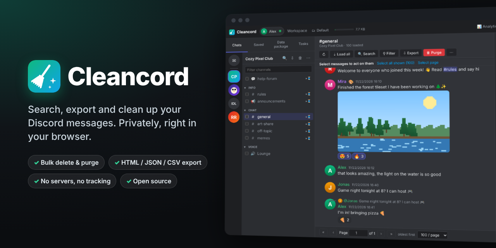
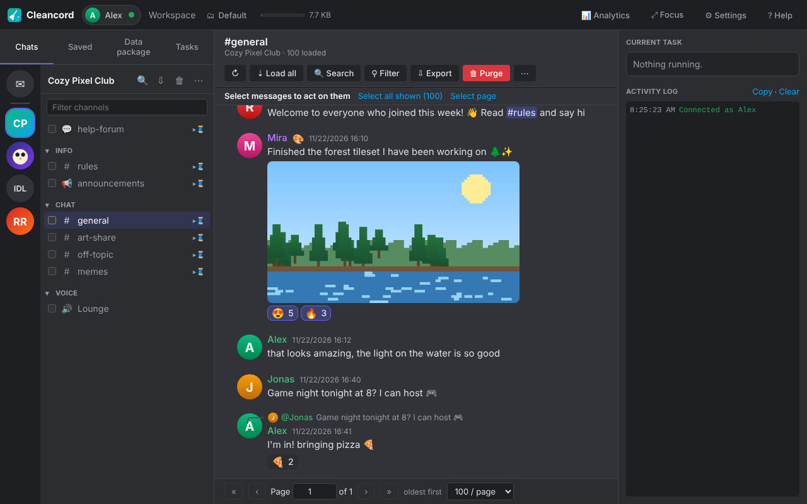
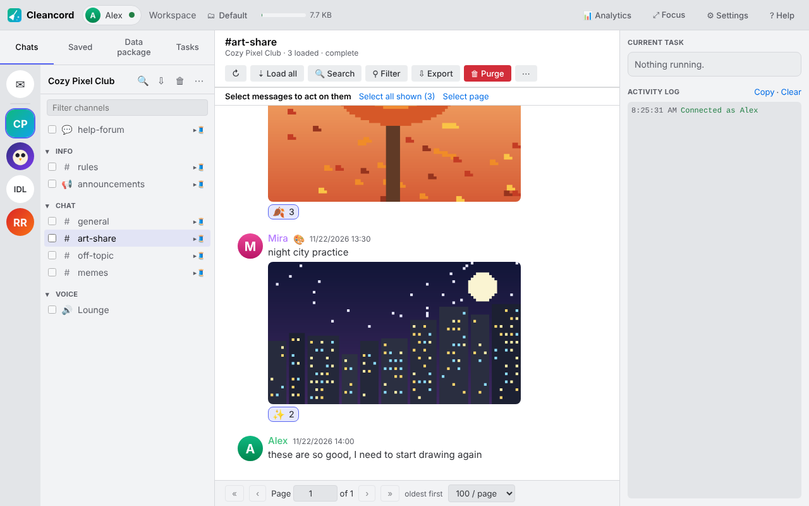
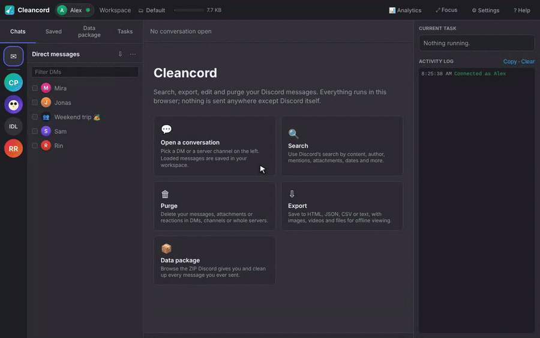
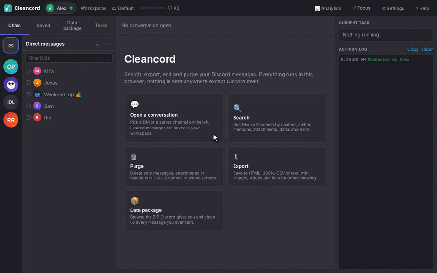
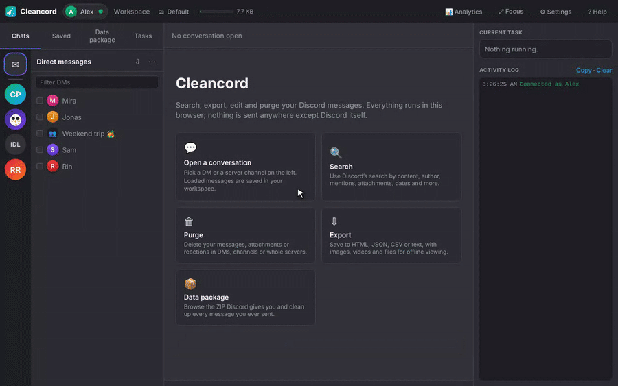
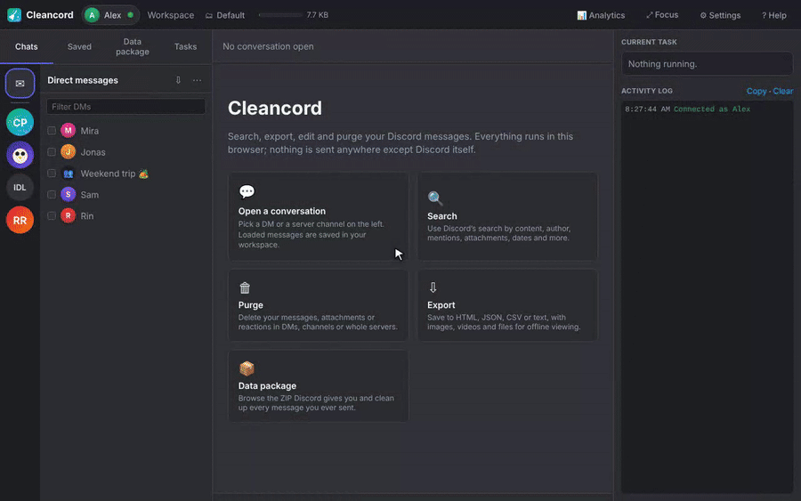
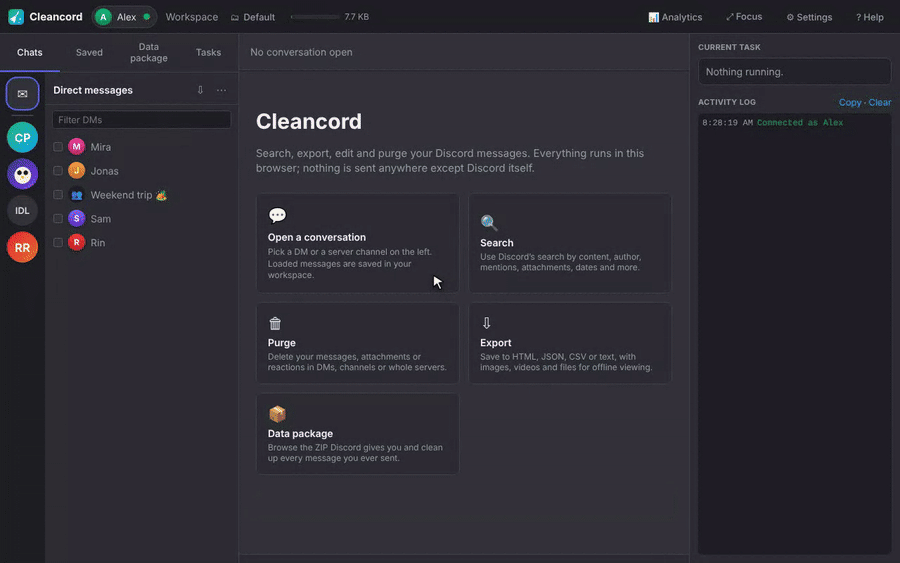
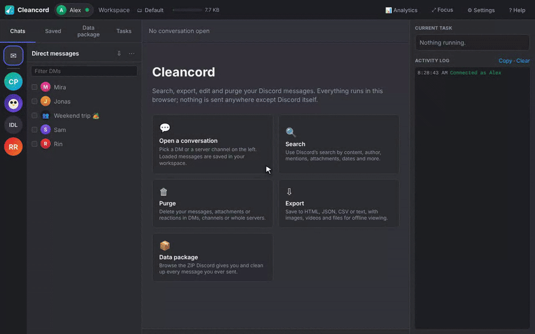

<div align="center">



<br>

[](../../releases/latest)
[](../../actions/workflows/ci.yml)
[](LICENSE)


**Cleancord** is a browser extension that lets you search, export, edit and bulk-delete your own Discord messages, in DMs, channels, threads or entire servers.<br>
It runs entirely in your browser. There is no server, no account, no analytics, and the code is small enough to read.

[**Download**](../../releases/latest) · [Features](#-features) · [How to use](#-how-to-use) · [Privacy](#-privacy--security) · [FAQ](#-faq)

</div>

> [!WARNING]
> **Automating a user account is against [Discord's Terms of Service](https://discord.com/terms)**, and Discord may act against accounts that do it. This applies to every tool of this kind. Cleancord waits 2 seconds between changes by default to stay well inside Discord's limits, but you use it at your own risk.

<br>

## ✨ Features

<table>
<tr>
<td width="50%" valign="top">

**🧹 Clean up**
- **Purge** a DM, several channels, or a **whole server**. Cleancord finds your messages itself.
- Delete messages, **strip attachments** (keep the text), or **remove reactions**.
- Filter by text, attachments, links, mentions, dates and pinned status.
- Catches what Discord's search misses, and unarchives and re-archives threads automatically.
- **Bulk edit** with find & replace (regex supported) and a live preview.

</td>
<td width="50%" valign="top">

**📦 Export**
- **HTML** that looks like Discord and works offline, plus **JSON**, **CSV** and **plain text**.
- Downloads images, videos, files, avatars and emojis next to the export.
- 10 presets, artist mode (media grouped by author), threads in their own folders.
- Streams to a folder or a ZIP on disk, so even huge servers fit, and can **resume** after a crash.

</td>
</tr>
<tr>
<td valign="top">

**🔍 Find**
- Discord's own search: content, author, mentions, attachments, dates, pinned, bots.
- Instant filters on loaded messages, with regex and an "inverse" switch.
- A Discord-style feed: replies, embeds, polls, forwards, role colors and nicknames.

</td>
<td valign="top">

**🗂️ Stay in control**
- Open Discord's **data package** to find every message you ever sent, even in servers you left.
- Long tasks can be paused, stopped and **resumed later**, even after closing the browser.
- Saved workspaces, mention statistics, and dark, light and midnight themes.

</td>
</tr>
</table>

<p align="center">
  
  
</p>

## 📥 Install

Cleancord isn't in the Chrome Web Store yet. Installing it takes about a minute:

1. **Download** `cleancord-vX.Y.Z.zip` from the [latest release](../../releases/latest) and unzip it somewhere permanent, for example your Documents folder. You get a folder called `cleancord`.
2. Open **`chrome://extensions`** (or `edge://extensions`, `brave://extensions`) and switch on **Developer mode** (top right).
3. Click **Load unpacked** and pick that `cleancord` folder (the one containing `manifest.json`).
4. Pin Cleancord from the puzzle-piece menu, then open **[discord.com](https://discord.com/app)** in the same browser and log in.

That's it: Cleancord picks up your session from your open Discord tab. Click the round Cleancord button on discord.com, or the toolbar icon, to open it.

> [!TIP]
> **Check your download.** Each release includes `SHA256SUMS.txt`. Run `sha256sum cleancord-vX.Y.Z.zip` (macOS: `shasum -a 256 …`, Windows: `certutil -hashfile … SHA256`) and compare. Only install Cleancord from this repository: tools that handle Discord sessions are a popular disguise for token stealers.

**Updating:** unzip the new version in the same place so it replaces the old `cleancord` folder, then press ↻ on Cleancord's card in `chrome://extensions`. Your saved conversations and settings stay. (Loading it from a different folder makes Chrome treat it as a new extension with empty storage.)

## 🚀 How to use

### 1. Browse and search

Pick a server or DM on the left. Messages load 100 at a time (**Load all** fetches everything). **Search** uses Discord's own search across a channel or the whole server, and **Filter** narrows down what's loaded.

<p align="center"></p>
<p align="center"></p>

### 2. Purge your messages

Open a DM or channel and press **🗑 Purge**, or use the 🗑 next to a server's name to purge **the whole server**: Cleancord finds your messages in every channel and thread itself. You can also tick several channels or DMs on the left and purge them all at once.

<p align="center"></p>

<details>
<summary><b>Purge options explained</b></summary>
<br>

| Option | What it does |
| --- | --- |
| **What to remove** | Delete messages, strip attachments only (the text stays), or remove reactions only |
| **Whose messages** | Yours (default); specific users or everyone only work where you have *Manage Messages* |
| **Only messages that…** | Contain text, have links/files/images/…, mention someone, fall in a date range, are (not) pinned |
| **System messages** | Optionally also delete pin notices, "thread created", joins and boosts where Discord allows it |
| **Method** | *Discord search* is fast; *Scan the full history* reads every message and finds everything search misses |
| **Final pass** | Re-checks the newest messages afterwards, because Discord's search index lags behind |

A purge can be paused, stopped, and resumed from the **Tasks** tab, even after a restart.

</details>

### 3. Edit or delete in bulk

Tick messages (shift-click selects a range, or use **Select all shown**), then **Delete**, **Edit**, **Remove attachments**, **Remove reactions** or **Export**. Edits show a before/after preview first.

<p align="center"></p>

### 4. Export

**⇩ Export** saves the open conversation, your selection, ticked channels, all DMs, or a whole server. The HTML export looks like Discord and works offline, with images and files saved next to it.

<p align="center"></p>

<details>
<summary><b>Export presets</b></summary>
<br>

| Preset | You get |
| --- | --- |
| Full archive | HTML + every image, video, file, avatar, emoji and sticker |
| HTML with images | HTML + images only (smaller) |
| HTML, media stays online | HTML that links to Discord's servers (attachment links expire after about a day) |
| HTML, text only | Just the conversation |
| JSON / CSV / Plain text | Raw data, spreadsheet, or readable text |
| Media only / artist mode | Just the files, optionally in a folder per author |
| Everything | All formats + all media |

Save your own combinations as presets too.

</details>

### 5. Clean up everything with your data package

Discord can send you a ZIP of all your data (**User Settings → Data & Privacy → Request all of my data**). Open it in the **Data package** tab to see every conversation you ever wrote in, including servers you've left and DMs you closed, then export it or delete it on Discord. **Fetch details** checks which messages still exist and adds reactions, edits and replies.

<p align="center"></p>

## 🔒 Privacy & security

| | |
| --- | --- |
| 🏠 **Local only** | No Cleancord server exists. Nothing is sent anywhere except Discord itself. |
| 🧱 **Enforced by the browser** | The extension's [Content Security Policy](extension/manifest.json) only allows connections to `discord.com` and Discord's media servers. Chrome blocks everything else. |
| 🔑 **Your session** | Read from your own Discord tab, kept **in memory only**, wiped when the browser closes. Never sent to media servers. *Forget session* clears it instantly. |
| 💾 **Your messages** | Stored in your browser so you can come back to them; remove them any time in the **Saved** tab. |
| 📜 **No remote code, no dependencies** | Every script is in [`extension/`](extension), plain JavaScript with no build step. |
| 🔁 **Reproducible releases** | Release ZIPs are built by [GitHub Actions](.github/workflows/release.yml) from the tagged source and published with SHA-256 checksums. |

See [PRIVACY.md](PRIVACY.md) for exactly what is stored where, and [SECURITY.md](SECURITY.md) to report a vulnerability.

<details>
<summary><b>Verify it yourself</b></summary>
<br>

```bash
# Every network call in the extension (three, all to Discord or the extension itself):
grep -rn "fetch(" extension/

# The Content Security Policy that blocks everything else:
grep -o '"extension_pages": "[^"]*"' extension/manifest.json
```

</details>

## ⚙️ Settings worth knowing

| Setting | Default | Notes |
| --- | --- | --- |
| Delay between deletions/edits | **2 s** (± 0.6 s random) | Slower is safer. Discord rate-limits fast changes, and Cleancord waits automatically when told to |
| Delay between searches | 1.5 s (± 0.6 s) | |
| Final pass | 100 newest messages | Catches messages Discord's search hasn't indexed yet |
| Server nicknames & role colors | On | One lookup per person, cached for 24 h |
| Launcher button on discord.com | On | Drag it up or down; turn it off in Settings |

## ❓ FAQ

<details>
<summary><b>Can my account get banned for using this?</b></summary>
<br>
Possibly. Discord's rules forbid automating user accounts ("self-bots"), whatever the tool. In practice Discord mostly targets spam and scraping, and deleting your own messages slowly is very different from that, but Discord doesn't publish how it decides. Keep the default delays, avoid running many big purges back to back, and split very large cleanups over several sessions (pause and resume work across restarts).
</details>

<details>
<summary><b>Can I delete other people's messages?</b></summary>
<br>
Only where you have the <i>Manage Messages</i> permission in a server. Nobody can delete someone else's messages in DMs. Call messages and a few system messages can't be deleted by anyone.
</details>

<details>
<summary><b>Why did a purge miss some messages?</b></summary>
<br>
Discord's search index lags behind and skips a few message types. The final pass handles recent ones; for a complete sweep, choose <b>Scan the full history</b> in the purge options. It's slower, but reads every message.
</details>

<details>
<summary><b>How do I clean up servers I've left or DMs I closed?</b></summary>
<br>
Closed DMs can be reopened with <b>Open DM with a user ID</b> (the ⋯ menu above the DM list), or from your friends list. For everything else, request your data package from Discord and open it in the <b>Data package</b> tab. Note that Discord doesn't let anyone delete messages in a server they're no longer in.
</details>

<details>
<summary><b>Does it work with the Discord desktop app, Firefox or my phone?</b></summary>
<br>
Cleancord works in Chrome, Edge, Brave and other Chromium-based browsers (version 116 or newer). Use Discord in the browser to connect it. Anything you delete is gone everywhere, including the desktop and mobile apps. Firefox and mobile browsers aren't supported yet.
</details>

<details>
<summary><b>Where is my data, and how do I remove it?</b></summary>
<br>
Loaded messages live in your browser's storage on this computer only. Remove them from the <b>Saved</b> tab, delete the workspace, or remove the extension. Your session is never written to disk.
</details>

## 🛠️ Development

The extension in [`extension/`](extension) is plain JavaScript and CSS with no build step: load the folder unpacked and edit. The tests run against a fake Discord API, so no account is needed:

```bash
npm ci          # dev tools only (acorn, fake-indexeddb)
npm run lint    # syntax + manifest/CSP checks
npm test        # logic tests: purge, export, ZIP, data package, rendering…
npm run build   # dist/cleancord-v<version>.zip + SHA256SUMS.txt
```

Contributions are welcome. Please read [CONTRIBUTING.md](CONTRIBUTING.md) first: the extension stays dependency-free and talks only to Discord.
The screenshots and GIFs above are recorded from a fictional demo server with [`scripts/demo/record.py`](scripts/demo/record.py).

## 📄 License & disclaimer

[MIT](LICENSE). Free to use, change and share.

Cleancord is an independent project and is **not affiliated with, endorsed by, or sponsored by Discord Inc.** "Discord" is a trademark of Discord Inc. and is used here only to describe what this tool works with. The software is provided as is, without warranty. You are responsible for how you use it and for following Discord's Terms of Service.
